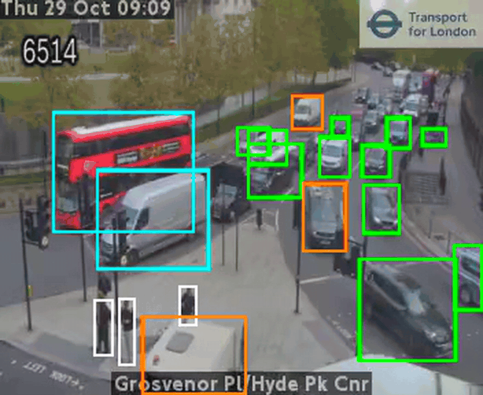
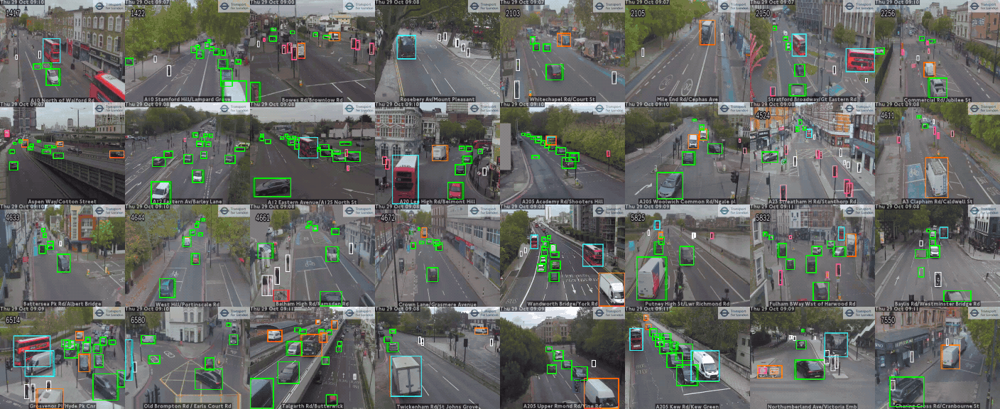
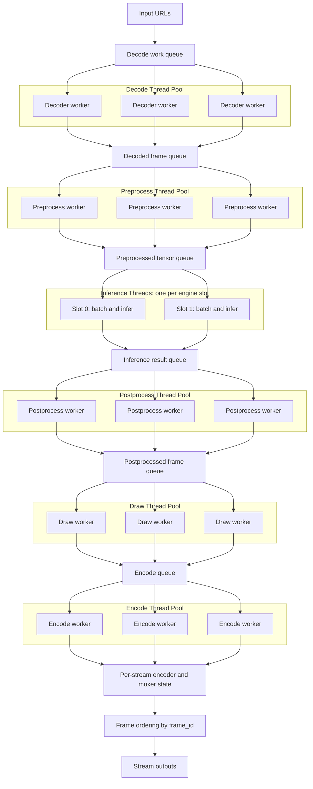
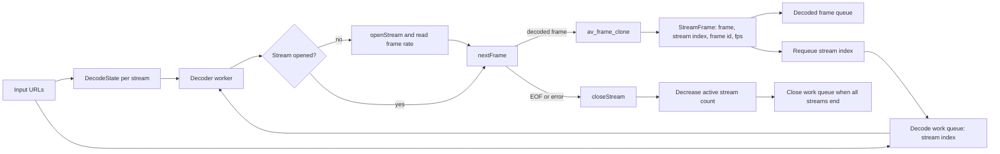
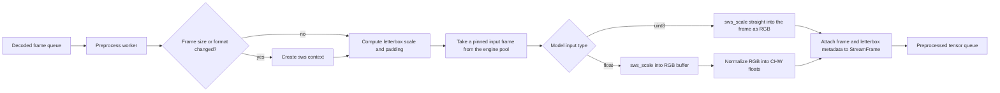
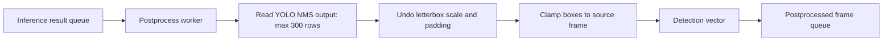
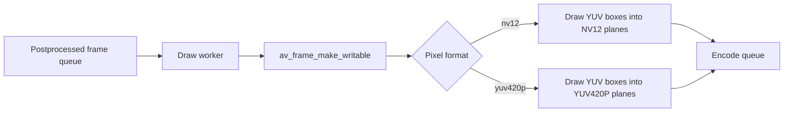
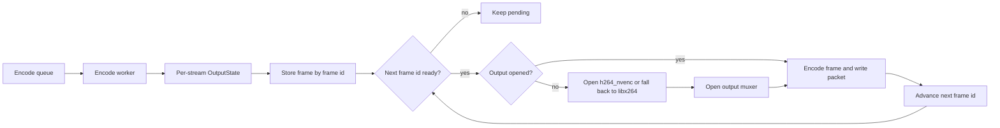

<div align="center">

# argus

**TensorRT YOLO Live Object Detection for Video Streams**

[](LICENSE)
[](https://en.cppreference.com/w/cpp/20)
[](https://cmake.org/)
[](https://developer.nvidia.com/tensorrt)

</div>

argus is a C++ live object detection pipeline for video streams. It decodes
inputs with FFmpeg/libav, preprocesses frames for YOLO, runs batched inference
(TensorRT on NVIDIA, with MIGraphX and OpenVINO backends as well), draws
bounding boxes on the decoded frame, encodes the result with NVIDIA NVENC or
libx264, and writes each processed stream to its own output.

The project is currently focused on learning and building the full video path
step by step.

## Demo

Single stream:

<p align="center">
  
</p>

Two streams:

<p align="center">
  
</p>

Thirty-two streams:

<p align="center">
  
</p>

The demos use public HLS traffic cameras processed with YOLO11s. Argus decodes
the inputs, runs TensorRT inference, draws detections, and writes processed HLS
outputs.

The one-stream and two-stream demos were captured as separate runs with only
those inputs active.

All demos were captured on an NVIDIA GeForce RTX 3070 Laptop GPU with 8 GB of
VRAM.

## Features

- **Stream Input**: Opens video inputs through FFmpeg/libav, including RTSP, HLS, HTTP media, and local files. Pass `--input` once per stream
- **NVIDIA Decode Path**: Prefers CUVID decoders such as `h264_cuvid` when the input codec supports them
- **Inference Backends**: TensorRT (NVIDIA), MIGraphX (AMD, untested on hardware) and OpenVINO (x86 CPUs, Intel GPUs), picked with `--device`
- **Batched Inference**: Frames from all streams are batched together. On CUDA two engine slots run at once, so one batch uploads while the other computes
- **Frame Preprocessing**: Letterboxes decoded frames straight into pinned input buffers, as float CHW or uint8 RGB depending on the model
- **Postprocessing**: Converts model output into detection boxes in source-frame coordinates, with NMS in the model or on the CPU
- **Bounding Box Overlay**: Draws detections directly onto the local decoded video frame
- **H.264 Encoding**: Prefers `h264_nvenc` and falls back to `libx264`
- **Stream Output**: Writes encoded packets to RTSP, HLS, MP4, MPEG-TS, or Matroska outputs through FFmpeg/libav
- **Profiling**: NVTX labels on every stage for Nsight Systems

## Pipeline

<div align="center">



</div>

Decode opens one FFmpeg decoder per input stream. Later stages use shared
queues and stage thread pools. Each inference thread collects a batch of up to
`min(streams, --batch)` frames and runs it on its own engine slot. With
TensorRT each slot has its own execution context, GPU buffers and CUDA stream,
so the two batches overlap. Encode keeps per-stream output state so each
stream is written in frame order.

Stream *i* writes to the `--output` URL with `-i` inserted before the
extension, so `output/argus.m3u8` becomes `output/argus-0.m3u8`,
`output/argus-1.m3u8`, and so on.

### Thread Allocation

Argus currently chooses stage thread counts automatically from
`std::thread::hardware_concurrency()`.

```text
reserved_threads =
  4 when hardware_threads >= 16
  2 when hardware_threads >= 8
  1 otherwise

inference_threads = engine slot count (2 on CUDA, 1 otherwise)
max_threads = hardware_threads - reserved_threads - inference_threads
```

The remaining worker threads are split across pipeline stages:

```text
decode      20%
preprocess  40%
postprocess 10%
draw        10%
encode      30%
```

Preprocess (resize, color convert, normalize on the CPU) is the busiest stage,
while decode and encode mostly wait on CUVID and NVENC. Each stage keeps at
least one thread because the configured defaults start at `1`. On a 16-thread
machine with the CUDA backend, the current split is:

```text
hardware_threads = 16
reserved_threads = 4
inference_threads = 2
max_threads = 10

decode      2 threads
preprocess  4 threads
postprocess 1 thread
draw        1 thread
encode      3 threads
inference   2 threads
```

The percentage math uses integer division, so unused remainder threads are not
assigned yet.

### Stage Details

Decode scheduling:



Preprocess:



Inference (one thread per engine slot):


Postprocess:



Draw:



Encode and output:



## Requirements

- CMake 3.23 or later
- A C++20 capable compiler
- At least one inference SDK:
  - CUDA Toolkit + TensorRT for NVIDIA GPUs
  - ROCm MIGraphX under `/opt/rocm` for AMD GPUs
  - OpenVINO for x86 CPUs and Intel GPUs
- FFmpeg development libraries:
  - `libavformat`
  - `libavcodec`
  - `libswscale`
  - `libavutil`
- An RTSP server for RTSP output, such as MediaMTX

The NVIDIA encoder path expects FFmpeg to provide:

```text
h264_nvenc
```

The decoder path attempts to use NVIDIA CUVID decoders when available, for
example:

```text
h264_cuvid
hevc_cuvid
av1_cuvid
```

## Build

```bash
cmake -B build
cmake --build build
```

CMake compiles every backend whose SDK it finds and fails if it finds none.
Skip one with `-DARGUS_ENABLE_TENSORRT=OFF`, `-DARGUS_ENABLE_MIGRAPHX=OFF` or
`-DARGUS_ENABLE_OPENVINO=OFF`. For OpenVINO from Intel's prebuilt archive, pass
`-DOpenVINO_DIR=<archive>/runtime/cmake`.

After exporting the YOLO ONNX model, build an engine file. `--device` picks
the backend (`auto`, `cuda`, `rocm`, `openvino`). An engine file only works
with the backend that built it:

```bash
./build/argus --build \
  --model input/models/yolo11s_dynamic_simplify_batchnms_u8_fp16.onnx \
  --engine output/yolo11s_dynamic_simplify_batchnms_u8_fp16.engine \
  --batch 16
```

Run the pipeline from an existing engine file:

```bash
./build/argus \
  --engine output/yolo11s_dynamic_simplify_batchnms_u8_fp16.engine \
  --input rtsp://source \
  --output rtsp://localhost:8554/argus
```

For several streams, repeat `--input`. They share the engine and are batched
together:

```bash
./build/argus \
  --engine output/yolo11s_dynamic_simplify_batchnms_u8_fp16.engine \
  --input rtsp://camera-a --input rtsp://camera-b --input rtsp://camera-c \
  --output output/argus.m3u8
```

## Output

The output type is selected from the `--output` URL:

```text
rtsp://localhost:8554/argus  RTSP
output/argus.m3u8            HLS
output/argus.mp4             MP4
output/argus.ts              MPEG-TS
output/argus.mkv             Matroska
output/argus.webm            WebM
```

For RTSP output, argus publishes to:

```text
rtsp://localhost:8554/argus
```

An RTSP server must already be running on `localhost:8554`. FFmpeg's RTSP
muxer publishes packets to that server. It does not replace a full RTSP server
process by itself.

With MediaMTX running locally, viewers can open:

```text
rtsp://localhost:8554/argus
```

For HLS output, argus writes a playlist and segment files:

```bash
./build/argus \
  --engine output/yolo11s_dynamic_simplify_batchnms_u8_fp16.engine \
  --input rtsp://source \
  --output output/argus.m3u8
```

The generated playlist can be checked with:

```bash
ffprobe output/argus.m3u8
```

## Source Layout

```text
src/
  decoder.*      input stream and packet-to-frame decoding
  preprocess.*   Frame conversion for YOLO input
  postprocess.*  Detection parsing and bounding box drawing
  encoder.*      AVFrame-to-H.264 packet encoding
  server.*       output muxing and packet writing
  main.cxx       Pipeline wiring

libs/
  engine/
    engine.*     Engine interface, input frame pool, backend dispatch
    cuda.*       TensorRT backend
    rocm.*       MIGraphX backend
    openvino.*   OpenVINO backend
  cxxopts.hpp    command line option parsing

utils/
  streams.*      stream and FFmpeg helpers
  logger.*       timestamped logging
  profiling.hxx  NVTX labels for Nsight Systems

tools/
  add_nms.py     adds batched NMS, uint8 input and fp16 to a YOLO ONNX model
```

## Model Export

The model runs NMS inside the graph, so each frame's output is small:

```text
[batch, 300, 6]    rows of x1, y1, x2, y2, conf, class, sorted by conf
```

Preprocessing keeps the source aspect ratio with letterbox padding. Postprocess
uses the recorded scale and padding to map model boxes back to source-frame
coordinates.

Export YOLO11s without NMS, then add batched NMS with `tools/add_nms.py`
(needs the `onnx` and `numpy` Python packages):

```bash
yolo export model=yolo11s.pt format=onnx imgsz=640 opset=17 dynamic=True simplify=True
python tools/add_nms.py yolo11s.onnx \
  input/models/yolo11s_dynamic_simplify_batchnms_u8_fp16.onnx \
  --uint8-input --fp16
```

The script defaults to conf 0.25, IoU 0.7 and 300 detections. Use `--conf`,
`--iou` and `--max-det` to change them. Two more flags make the model faster:

- `--uint8-input` makes the input `[batch, 640, 640, 3]` uint8 RGB and does the
  cast, divide by 255 and transpose inside the model. Each frame crosses PCIe as
  1.2 MB instead of 4.9 MB, and the output is identical.
- `--fp16` runs the YOLO layers in fp16. The NMS block stays fp32 because the
  class-offset boxes go past fp16's 65504 maximum. TensorRT builds strongly
  typed networks, so precision comes only from the types in the ONNX file. At
  16 streams it is about 2x faster than fp32, with a median box IoU of 0.991
  against fp32. Only boxes near the 0.25 threshold differ.

argus reads the input type from the engine, so float and uint8 models both
work without other changes.

Don't use Ultralytics' own `nms=True` export. It unrolls NMS for the export-time
`batch`, so a `batch=1` export only returns detections for the first frame of
every inference batch. `add_nms.py` uses ONNX `NonMaxSuppression`, which
handles any batch size.

A model without NMS (`[batch, 4 + classes, anchors]`) also works. Postprocess
then runs NMS on the CPU, but each frame's output is 2.8 MB instead of 7 KB,
which costs about 20% throughput with TensorRT.

## Profiling

Every stage thread is named and each unit of work is wrapped in an NVTX range,
so an Nsight Systems timeline shows when each thread is working and when it is
waiting:

```bash
nsys profile -o output/profile/argus --force-overwrite=true \
  --trace=cuda,nvtx --cpuctxsw=process-tree --sample=none \
  ./build/argus --engine ... --input ... --output ...
nsys stats --report nvtx_sum output/profile/argus.nsys-rep
```

Profiling 16 streams of a 300-frame clip on an RTX 3070 Laptop GPU, these
changes took the run from 27.0 s to 7.0 s:

| Change | Run time |
|---|---|
| Starting point | 27.0 s |
| NVENC encoders share one CUDA context | 23.9 s |
| Pinned host memory for input frames | 19.7 s |
| Two engine slots on separate CUDA streams | 17.7 s |
| Rebalanced stage thread counts | 16.6 s |
| uint8 model input | 16.4 s |
| fp16 model | 8.05 s |
| NVENC and TensorRT share the primary CUDA context | 6.98 s |

Inference went from about 180 to about 770 frames per second. That works out
to roughly 20 live 30 fps streams on this GPU, with room to spare. Consumer
GeForce cards also cap NVENC at 12 concurrent sessions, so beyond that,
encoding falls back to libx264.

## Development Notes

The frame overlay code writes directly into decoded YUV buffers. It currently
supports `nv12`, `yuv420p`, and `yuvj420p`. The NVIDIA CUVID H.264 path commonly
outputs `nv12`. If a stream decodes to another pixel format, the frame must be
converted before drawing and encoding, or the drawing path must be updated for
that format.

The encoder and output muxer are separated:

```text
encoder = raw AVFrame to compressed AVPacket
server  = compressed AVPacket to stream output
```

This separation keeps the video compression step independent from the output
transport step.

## Contributing

Contributions are welcome.

### Areas to Improve

1. Keep frames on the GPU between decode, preprocess and encode. NVENC uploads currently spend about 1.8 ms per frame in `cuMemcpy2DAsync`.
2. Share one CUDA context with the CUVID decoders too.
3. Test the ROCm MIGraphX backend on an AMD GPU.
4. Expand stream input and output coverage, including webcams and additional network protocols.
5. Add structured logging for FFmpeg and inference errors.
6. Add small integration tests for decoder, encoder, and muxer setup.

### Style

- Keep code C++20.
- Prefer clear ownership of FFmpeg objects in small structs.
- Keep decode, inference, encode, and output responsibilities separated.
- Check FFmpeg return values and print readable errors with `av_strerror`.
- Avoid adding unrelated refactors when changing one part of the pipeline.

## License

GNU Affero General Public License v3.0. See [LICENSE](LICENSE) for the full
text.
